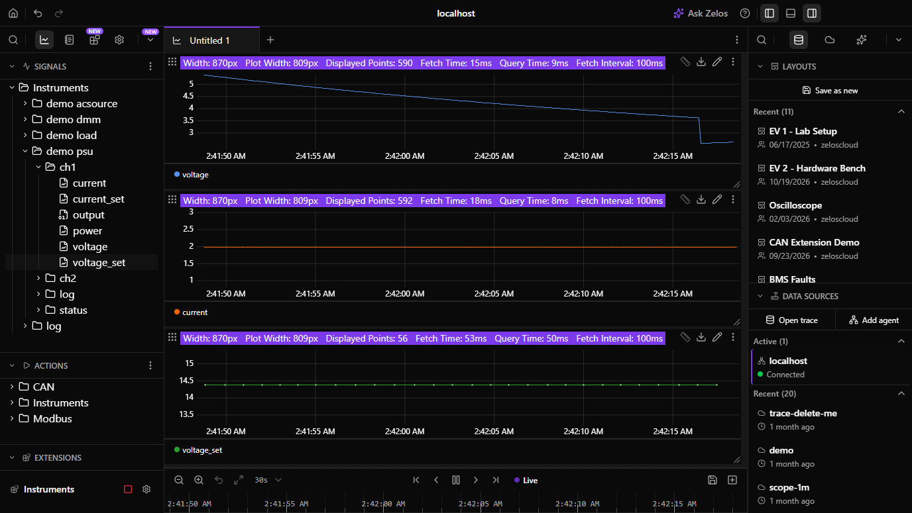
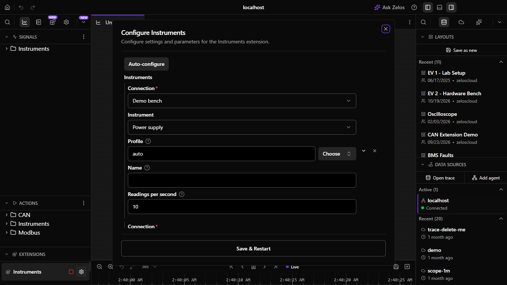
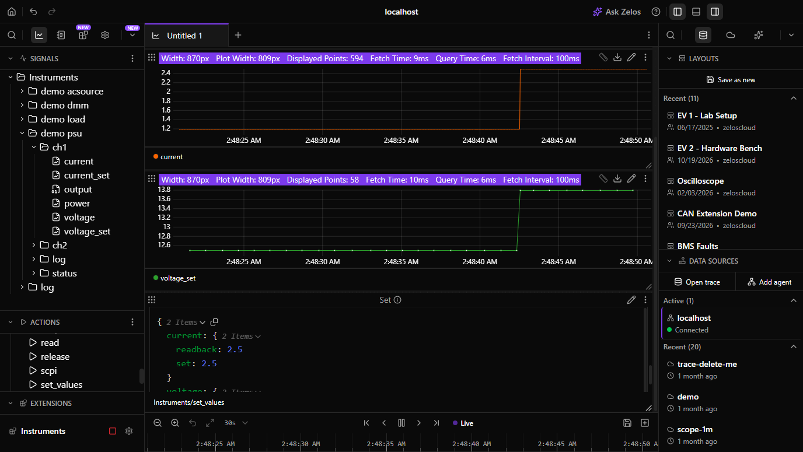

# Instruments

Record bench instruments on the same timeline as the device under test, and set them from the app or a notebook.

- 📈 **Every reading a signal**: a supply's voltage, current and power, a load's resistance, a meter's reading, an AC source's frequency and power factor, each with its unit.
- 🎛️ **Setpoints, output and mode too**: what the instrument was told to do sits beside what it measured, and a knob turned at the bench shows up as a change.
- 🔁 **Same names on every vendor**: `psu/ch1.voltage` is the measured voltage on a Rigol, a Keysight or a Siglent, so a notebook written for one bench works on the next.
- 💬 **Set from the app, a notebook or Zelos AI**: voltage, current limit, a load's function, an output switch. Each set is checked against the instrument's range and your limits, and confirmed by the readback.
- 🧩 **One file per instrument**: profiles written from the programming manuals ship for the most used supplies, loads, meters and AC sources. Add your own as one TOML file, no code.
- 🔎 **Auto-configure finds the bench**: instruments on the network, on USB and on the serial ports of known instrument vendors, each matched to its profile by its identity.
- 🔌 **Any connection**: a raw LAN socket, USB-TMC, a serial port, or any VISA resource (VXI-11, HiSLIP, GPIB through a vendor VISA), on Linux, macOS and Windows, with nothing to install.



## What it records

| | |
|---|---|
| **Instruments** | DC power supplies (including bidirectional), electronic loads, multimeters, AC sources |
| **Connections** | LAN raw socket, USB-TMC, serial (COM, `/dev/tty*`), any VISA resource string, and a built-in demo bench |
| **Profiles** | One per instrument family, shipped for Keysight, Rigol, Siglent, Keithley, Rohde & Schwarz, B&K Precision, GW Instek, ITECH, Chroma, Kikusui, EA, TDK-Lambda, Fluke and more; generic profiles for any instrument that follows SCPI |
| **Runs on** | Linux, macOS and Windows, with Zelos 26.0.10 or later |

## Quick start

1. **Configure**: press **Auto-configure**. It adds one entry for each instrument it finds, with its profile and a name from its model and serial number. Or add an entry yourself: pick the connection, pick the instrument from the list, and leave Profile on **Automatic**.
2. **Start** Instruments. The signals appear under `Instruments/<name>/ch1`, and the log shows what connected.
3. **Set** something: open the Action panel, pick **Set**, choose the instrument and channel, type a voltage. The readback comes back in the result and the log says what changed.

No hardware? Press Auto-configure with nothing connected and it adds the demo bench: a supply charging a battery, a load discharging it, a meter on the shunt and an AC source feeding the charger, all running on their own.



## One reading, recorded

A Rigol DP832 on channel 1 answers `:MEAS:ALL? CH1` with `12.0010,0.4998,5.998`. Instruments writes, at the moment the query was sent plus half the round trip:

| Event | What lands |
|---|---|
| `Instruments/psu/ch1` | `voltage` = 12.001 V, `current` = 0.4998 A, `power` = 5.998 W |

Once a second it also reads the setpoints and the state:

| Event | What lands |
|---|---|
| `Instruments/psu/ch1` | `voltage_set` = 12 V, `current_set` = 1 A, `output` = true, `mode` = cv, `protection` = none |
| `Instruments/psu/status` | `rtt_ms` = 18.4, `rate_hz` = 9.9, `errors` = 0, `connected` = true |

## What it records

All events go under one trace source, `Instruments` by default (**Prefix** in Advanced (all instruments)). Each instrument has a name, set by **Name** in the config, or taken from its address.

| Event | Holds |
|---|---|
| `Instruments/<name>/ch<n>` | The channel's measurements every interval, and its setpoints, output, mode and protection once a second. Field names are the same for every vendor: see [Signals](#signals). |
| `Instruments/<name>/<function>` | A multimeter's reading, under the active function (`dc_voltage`, `resistance`, ...), so each keeps its unit. |
| `Instruments/<name>/status` | `rtt_ms`, the round trip of the last measurement query; `rate_hz`, the readings per second achieved over the last 10 s; `errors`, the instrument errors seen since start; `connected`. |
| `Instruments/<name>/poll` | The extra readings from the config's poll table, one field each. |
| `Instruments/<name>/log` | Connects and disconnects, every set with its source, setpoint changes made at the front panel or by another program, mode and protection changes, and the instrument's own errors. |
| `Instruments/log` | The extension's own log. |

In the Log panel, the **Source** column shows `action` for a set from the app or a notebook, `instrument` for an error the instrument reported, `tx` and `rx` for raw commands, and `instruments` for the extension's notes.

### Signals

| Category | Measured every interval | Read once a second |
|---|---|---|
| Power supply | `voltage` V, `current` A, `power` W | `voltage_set` V, `current_set` A, `ovp_set` V, `ocp_set` A, `output`, `mode`, `protection` |
| Electronic load | `voltage` V, `current` A, `power` W, `resistance` Ω | `current_set` A, `voltage_set` V, `power_set` W, `resistance_set` Ω, `output` (the input), `mode`, `protection` |
| AC source | `voltage` V rms, `current` A rms, `power` W, `apparent_power` VA, `power_factor`, `frequency` Hz | `voltage_set` V, `frequency_set` Hz, `current_set` A, `output`, `protection` |
| Multimeter | `value`, under the active function's event | `function` |

`mode` is `off`, `cv`, `cc`, `cp`, `cr`, `unregulated` or `unknown`; for a load it is the configured function. `protection` is `none`, `ovp`, `ocp`, `opp`, `otp` or `other`. Both show as labels in the app and come back as text from the SDK.

A profile records only what its instrument answers. A generic profile probes the standard queries at start and drops the ones the instrument rejects, with one line in the log.

### Timing

Instruments have no usable clock, so every reading is stamped on the host: the moment the query was sent plus half the round trip. The round trip is `status.rtt_ms`, so the error bound is always in the trace.

**Readings per second** sets how often the measurements are read, 10 by default. The instrument's own turnaround is the floor: ask for more than it answers and it reads back to back, `status.rate_hz` shows what it achieves, and Get State says so. Setpoints, the error queue and the poll table are read on their own intervals, so a slow setpoint pass never costs a measurement.

## Configuration

The config holds a list of `instruments` and one `advanced` group. Each instrument picks a **Connection**:

| Connection | Reads | Fields |
|---|---|---|
| `lan` (LAN) | A raw SCPI socket | **Host** (from the list, or typed), **Port** (empty uses the profile's default, 5025 for most instruments) |
| `usb` (USB) | A USB-TMC instrument | **Device** (from the list, or a VISA resource string) |
| `serial` (Serial port) | RS-232 or a USB-serial bridge | **Port** (from the list, or a path), **Baud** (empty uses the profile's default) |
| `visa` (VISA resource) | Anything VISA names: `TCPIP0::host::inst0::INSTR`, `TCPIP0::host::hislip0::INSTR`, `GPIB0::5::INSTR` | **Resource**, **VISA library** |
| `demo` (Demo bench) | A simulated instrument | **Instrument**: supply, load, meter or AC source |

Every entry has a **Profile** (Automatic, a shipped profile, or the path to your own file), a **Name**, and **Readings per second**. Advanced holds **Limits** (the most the extension will ever set, whatever the instrument allows), **Keep the front panel usable**, **Channels**, the reply timeout, the delay between commands, the line ending, and **Extra readings**: any query whose reply is a number, recorded as its own signal.

The config is checked when the extension starts. A mistake logs one sentence that names the instrument and the field, then the extension exits.

### Examples

```json
{ "instruments": [{ "connection": "lan", "host": "192.168.1.40", "profile": "auto", "name": "psu" }] }
```

```json
{ "instruments": [
    { "connection": "usb", "resource": "USB0::0xF4EC::0x1430::SDL13GCX::INSTR", "profile": "siglent-sdl1000x", "name": "load", "rate_hz": 5 },
    { "connection": "serial", "port": "/dev/ttyUSB1", "baud": 9600, "profile": "keysight-e36100", "name": "aux",
      "advanced": { "limits": { "max_voltage": 15, "max_current": 2 } } } ] }
```

```json
{ "instruments": [{ "connection": "demo", "category": "psu" }, { "connection": "demo", "category": "load" }] }
```

### Profiles

A profile is one TOML file that says how to recognise an instrument family, what to read, what can be set and what the replies mean. The shipped ones are listed by **List Profiles** and in [`profiles/`](profiles/). Each carries an evidence badge:

| Badge | Means |
|---|---|
| `manual` | Transcribed from the programming manual; no unit seen yet. |
| `transcript` | A transcript recorded from a real unit replays against the profile in the tests. |
| `hardware` | Runs on the nightly bench. |

Your own profile loads the same way: set **Profile** to the path of your file, or put files under `profiles/` in the extension's data directory. [docs/profiles.md](docs/profiles.md) is the format, and `just record` writes a transcript from your unit so the profile can earn its badge.

### The VISA library

LAN sockets and serial ports need nothing installed. USB-TMC, VXI-11, HiSLIP and GPIB go through [pyvisa](https://pyvisa.readthedocs.io/): the built-in pure-Python library serves LAN protocols and USB on every platform, and a vendor VISA (NI-VISA, Keysight IO Libraries, R&S VISA) is used automatically for USB and GPIB when one is installed, because on Windows it owns the device. Without a vendor VISA on Windows, bind the instrument to WinUSB once with [Zadig](https://zadig.akeo.ie/). On Linux, give your user access to the device with a udev rule.

## Actions

Every action except List Instruments, List Profiles and Auto-configure takes `instrument`, the instrument's **Name**. Leave it out to act on the first configured instrument. Channel actions take `channel`, from 1.

| Action | Path | What it does | Read-only |
|---|---|---|---|
| List Instruments | `Instruments/list_instruments` | Instruments found on the network or on USB, or every serial port, for the address fields. Works while the extension is stopped. | yes |
| List Profiles | `Instruments/list_profiles` | The shipped profiles with their badge, for the Profile field. | yes |
| Auto-configure | `Instruments/auto_config` | Keeps the configured instruments and adds one for each instrument found, or the demo bench when there are none. Probes a serial port only when its USB vendor is a known instrument maker. | yes |
| Set | `Instruments/set_values` | Sets any of voltage, current, power, resistance, frequency, OVP, OCP and function on a channel. Each value is checked against the profile's range and your limits, sent, checked against the instrument's error queue, and read back. | no |
| Output | `Instruments/output` | Switches a channel's output, or a load's input, on or off. | no |
| Read | `Instruments/read` | A fresh measurement of every signal on a channel, now. | yes |
| Get State | `Instruments/get_state` | Health, identity, profile, channels with their ranges and last values, counters, and the last commands. | yes |
| SCPI | `Instruments/scpi` | Sends any command and returns the reply for a query. Logged. Nothing is checked. | no |
| Clear | `Instruments/clear` | Clears a channel's latched protection and drains the error queue. The output stays off. | no |
| Local | `Instruments/local` | Gives the front panel back. | no |
| Release | `Instruments/release` | Closes the link so another program can use the instrument. Outputs stay as they are. | no |
| Acquire | `Instruments/acquire` | Takes a released instrument back. | no |

A set returns what was sent and what the instrument reads back:

```json
{ "voltage": { "set": 12.0, "readback": 12.0 }, "current": { "set": 2.0, "readback": 2.0 } }
```

A failed action returns one sentence that says why: the range, the limit, the instrument's own error text, or a readback that disagrees.



### From a notebook

```python
from zelos_sdk import connect

with connect() as agent:
    agent.actions.execute(
        "Instruments/set_values",
        {"instrument": "psu", "channel": 1, "voltage": 12.0, "current": 2.0},
    )
    agent.actions.execute("Instruments/output", {"instrument": "psu", "channel": 1, "on": True})
    frame = agent.query("Instruments/psu/ch1.*", start="-1m")
```

### From the command line

```bash
zelos actions execute Instruments/set_values --params '{"instrument": "psu", "channel": 1, "voltage": 12.0}'
zelos actions execute Instruments/read --params '{"instrument": "psu"}'
```

## What the extension never does

- It never sends `*RST` or any command that resets an instrument.
- It never changes an output when it connects, reconnects, stops or crashes, and never re-applies a setpoint after a reconnect.
- It never sets a value outside the profile's range or above a limit in the config, and it fails a set whose readback disagrees.
- It never runs a write without asking when Zelos AI drives it: only List, Read and Get State are read-only.

## Reconnects and health

When an instrument stops answering or the link fails, the extension closes it and tries again, from 0.5 s up to every 10 s, until it answers. The gap shows in the trace as a `connected` = false status row. Get State returns one health sentence that says what to do:

| Health | Also know |
|---|---|
| `Connecting to <where>.` | The first open has not finished. |
| `Cannot open <where>: <reason>. <advice> Retrying.` | The reason comes from the link; the advice names the usual fix: the host and port, the device being plugged in, another program holding it, or a permission. |
| `Lost <where>: <reason>. Reconnecting.` | Three queries in a row got no reply, or the link broke. |
| `Connected to <maker> <model>. Reading <n> signals on <c> channels at <x> Hz (target <y> Hz).` | With a note when the instrument answers slower than the target, and the last instrument error. |
| `Released <where>; run Acquire to take it back.` | Release closed it on purpose. |

## Limits

- Oscilloscopes and waveform generators are not supported: their data are waveforms, not readings.
- Instruments that speak a reverse-engineered protocol instead of SCPI (Korad and Tenma supplies, among others) have no profile.
- A profile marked `manual` was written from the manual and has not been run against a unit. If yours answers differently, Get State shows the last commands and replies, and a transcript recorded with `just record` makes the fix a test.
- USB-TMC through the built-in library has open issues with some Rigol and Siglent units; use LAN where the instrument has it, or a vendor VISA.
- One instrument is one connection. Instruments that accept a single client refuse a second program while the extension holds them; use Release.
- On Windows, the agent ends the extension without a final flush, so the last batch of rows may be lost.

## Development

See [CONTRIBUTING.md](CONTRIBUTING.md) for the prerequisites, every `just` command, a local run, the fake instrument and the transcript recorder.

## Links

- **Repository**: [github.com/zeloscloud/zelos-extension-instruments](https://github.com/zeloscloud/zelos-extension-instruments)
- **Issues**: [github.com/zeloscloud/zelos-extension-instruments/issues](https://github.com/zeloscloud/zelos-extension-instruments/issues)
- **Extensions in Zelos**: [docs.zeloscloud.io/latest/app/extensions](https://docs.zeloscloud.io/latest/app/extensions/)

## License

MIT. See [LICENSE](LICENSE).
