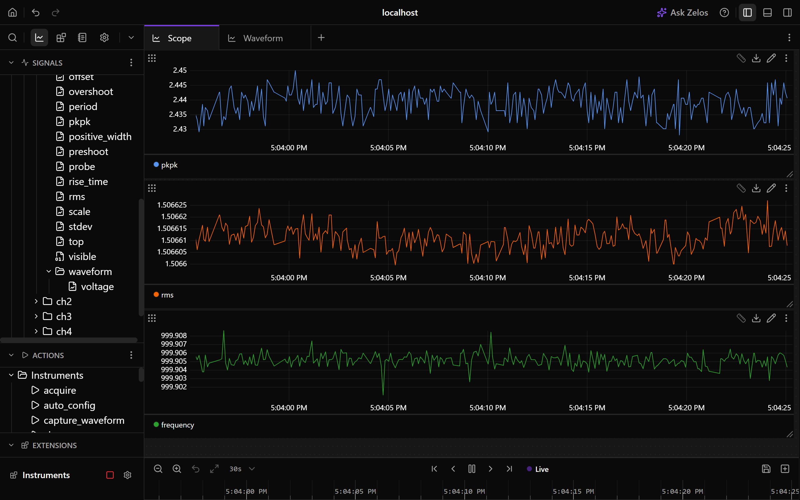

# Instruments

Record your bench instruments in Zelos, on the same timeline as the device you are testing, and set them from the app, a notebook or Zelos AI.

- 📈 **Every reading is a signal**: a supply's voltage and current, a load's power, a meter's reading, a scope's measurements, each with its unit.
- 🔎 **Finds your bench**: Auto-configure looks on the network, USB and serial ports, and picks each instrument's profile from its identity.
- 🎛️ **Sets it safely**: every value is checked against the instrument's range and your limits, then confirmed by reading it back.
- 🔬 **Scopes too**: the measurements on screen are recorded live, and Capture Waveform brings a channel's samples into the trace.
- 🔁 **Same names on every vendor**: `psu/ch1.voltage` means the same on a Rigol, a Keysight or a Siglent, so a notebook works on any bench.

[](assets/readme/hero.mp4)

## Works with

| Instrument | Makers and families |
|---|---|
| **DC power supplies** | Keysight E36100, E36200, E36300, N6700, N8900 · Agilent N5700 · Rigol DP700, DP800, DP900, DP2000 · Siglent SPD1000X, SPD3303X, SPS5000X · Rohde & Schwarz HMP, NGE100B, NGL200, NGM200, NGP800 · Keithley 2200, 2220, 2230, 2260B, 2280S, 2400 · B&K Precision 9115, 9130B, 9140, 9200B · GW Instek GPD, GPP, PSW · TDK-Lambda Genesys · EA Elektro-Automatik · ITECH IT6000C, IT6100B · Chroma 62000P · Magna-Power · Delta Elektronika · OWON |
| **Electronic loads** | Keysight EL30000 · Rigol DL3000 · Siglent SDL1000X · Keithley 2380 · B&K Precision 8500B, 8600 · Chroma 63200A · ITECH IT8500+, IT8800 · GW Instek PEL-3000 · Kikusui PLZ-5W |
| **Multimeters** | Keysight 34401A, 34460A, 34461A, 34465A, 34470A · Keithley 2000, 2110, DMM6500, DMM7510 · Fluke 8845A, 8846A · Siglent SDM3045X, SDM3055, SDM3065X · GW Instek GDM-9060 · B&K Precision 5491B, 2831E · OWON XDM2041 |
| **AC sources** | Keysight AC6800B · Chroma 61600 · ITECH IT7800 |
| **Oscilloscopes** | Siglent SDS |
| **Anything else that speaks SCPI** | A generic profile per category reads the standard commands, and your own instrument is one TOML file away: see [profiles](docs/profiles.md). |

Instruments connect over LAN, USB-TMC, a serial port, or any VISA resource (VXI-11, HiSLIP, GPIB through a vendor VISA), on Linux, macOS and Windows, with Zelos 26.0.10 or later.

## Get started

1. Install **Instruments** from Extensions and open its settings.
2. Press **Auto-configure**. Each instrument it finds gets an entry with its connection and profile. Give it a short name: it becomes the folder its signals sit under.
3. Press **Save & Start**. The instrument appears under **Instruments** in the signal tree. Double-click a signal to plot it.




- **An instrument on another subnet** does not answer the searches. Add an entry and type its address.
- **No hardware?** Press Auto-configure with nothing connected and it adds a demo bench: a supply charging a battery, a load discharging it, a meter and an AC source.

## Set and capture

Actions show up under **Instruments** in the Actions list. Double-click one to add it to the layout.

- **Set** a voltage, current, power, resistance, frequency or protection level. The result shows what was sent and what the instrument read back.
- **Output** switches a channel on or off.
- **Measure** puts a measurement in one of a scope's slots, and it is recorded from then on.
- **Capture Waveform** fetches a scope channel's samples, up to the whole acquisition, into the trace at the moment of the capture.
- **SCPI** sends any command, for anything the profile does not cover.


The same actions run from a notebook or the command line:

```python
from zelos_sdk import connect

with connect() as agent:
    agent.actions.execute(
        "Instruments/set_values", {"instrument": "psu", "channel": 1, "voltage": 12.0}
    )
    agent.actions.execute("Instruments/output", {"instrument": "psu", "channel": 1, "on": True})
```

```bash
zelos actions execute Instruments/capture_waveform --params '{"instrument": "scope", "channel": 1}'
```

## Safe on a live bench

- It never touches an output when it connects, reconnects, stops or crashes.
- It never sends `*RST`. The SCPI action sends exactly what you type.
- It refuses a value outside the instrument's range or above a limit you set, before sending anything.
- Zelos AI asks before every action that changes an instrument.

## When something is wrong

| You see | Do this |
|---|---|
| Auto-configure finds nothing | Check the instrument is on the same subnet as this computer, or type its address in a new entry. |
| `<host> is on the network, but port 5025 is not accepting connections` | Many instruments serve one client on their SCPI port and keep it held after a program vanishes. Use the VISA resource the message names, or power-cycle the instrument. |
| A USB instrument is listed but cannot be read | On Windows, install the vendor's VISA or bind the device to WinUSB with [Zadig](https://zadig.akeo.ie/). On Linux, add a udev rule for your user. |
| A reading you expected is missing | Run **Get State**. It shows the last commands and replies; a profile marked `manual` has not run on a real unit yet. |

## Reference

Every event and signal, the timing model, every config field, every action and every health message are in [docs/reference.md](docs/reference.md). The profile format is in [docs/profiles.md](docs/profiles.md).

## Development

See [CONTRIBUTING.md](CONTRIBUTING.md) for the prerequisites, every `just` command, a local run, the fake instrument and the transcript recorder.

## License

MIT. See [LICENSE](LICENSE).
