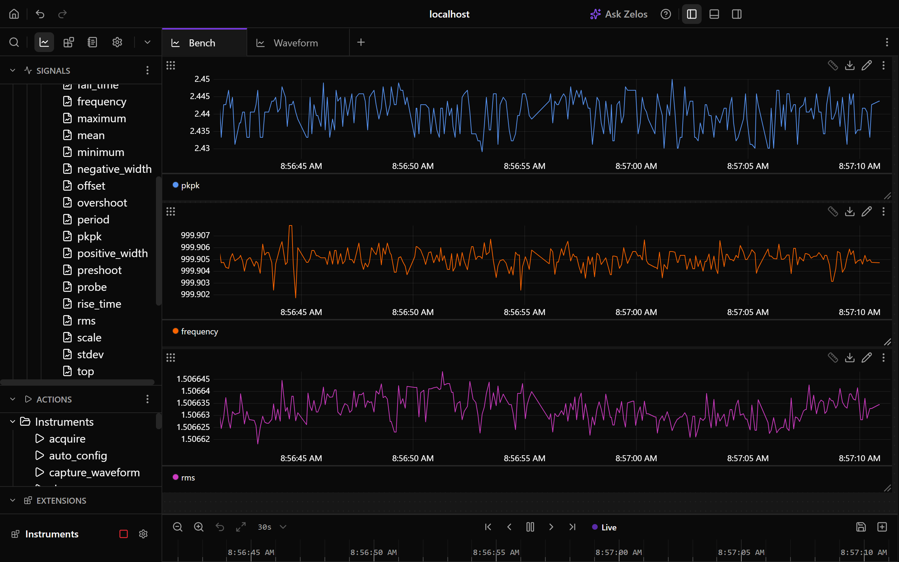
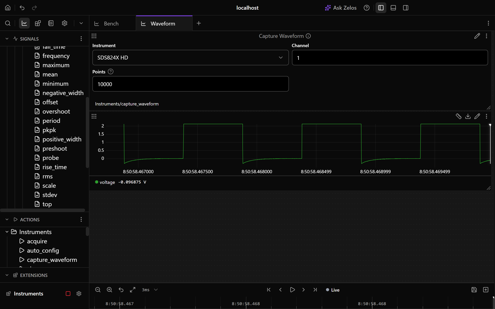

# Instruments

Record your bench instruments in Zelos, on the same timeline as the device you are testing, and control them from the app.

- 📈 **Every reading is a signal**: a supply's voltage and current, a load's power, a meter's reading, a scope's measurements, a data-acquisition unit's channels, each with its unit.
- 🔎 **Finds your bench**: Auto-configure searches the network, USB and serial ports, and recognizes each instrument it finds.
- 🎛️ **Sets it safely**: every value is checked against the instrument's range and your limits, then confirmed by reading it back.
- 🔬 **Scopes too**: the measurements on screen are recorded live, and Capture Waveform brings a channel's samples into the trace.
- 🎚️ **Generators and loggers**: set a function generator's waveform, modulation, burst and sweep, and scan a data-acquisition unit's channels and relays.
- 🔁 **Same names on every vendor**: `ch1.voltage` means the same on a Rigol, a Keysight or a Siglent.

[](assets/readme/quickstart.mp4)

## Works with

| Instrument | Makers and families |
|---|---|
| **DC power supplies** | Keysight E36100, E36200, E36300, E36731A, N6700, N8900 · Agilent N5700 · Rigol DP700, DP800, DP900, DP2000 · Siglent SPD1000X, SPD3303X, SPS5000X · Rohde & Schwarz HMP, NGE100, NGL200, NGM200, NGP800 · Keithley 2200, 2220, 2230, 2260B, 2280S, 2400 · B&K Precision 9115, 9116, 9130B, 9140, 9200B · GW Instek GPD, GPP, PSW · TDK-Lambda Genesys · EA Elektro-Automatik · ITECH IT6000C, IT6100B · Chroma 62000P · Magna-Power · Matrix WPS300S · Delta Elektronika · OWON |
| **Electronic loads** | Keysight EL30000 · Rigol DL3000 · Siglent SDL1000X · Keithley 2380 · B&K Precision 8500B, 8600 · Chroma 63200A · ITECH IT8500+, IT8800 · GW Instek PEL-3000 · Kikusui PLZ-5W |
| **Multimeters** | Keysight 34401A, 34460A, 34461A, 34465A, 34470A · Keithley 2000, 2110, DMM6500, DMM7510 · Fluke 8845A, 8846A · Siglent SDM3045X, SDM3055, SDM3065X · GW Instek GDM-9060, GDM-9061 · B&K Precision 5491B, 2831E · OWON XDM2041 |
| **AC sources** | Keysight AC6800B · Chroma 61600 · ITECH IT7800 |
| **Function generators** | Keysight 33500B, 33600A · Rigol DG800, DG800 Pro, DG900 Pro, DG1000Z · Siglent SDG1000X, SDG1000X Plus, SDG2000X, SDG6000X |
| **Oscilloscopes** | Siglent SDS800X HD, SDS1000X HD, SDS2000X HD, SDS2000X Plus, SDS3000X HD, SDS5000X, SDS6000A, SDS6000 Pro, SDS6000L, SDS7000A, and the older SDS1000X, SDS1000X+, SDS1000X-E, SDS2000X, SDS2000X-E · Keysight InfiniiVision 1200 X-Series · Tektronix 2 Series MSO22, MSO24 |
| **Data-acquisition units** | Keysight 34970A, 34972A, DAQ970A, DAQ973A, 34980A · Keithley DAQ6510 |
| **Anything else that speaks SCPI** | A generic profile for each category except oscilloscopes and DAQ units reads the standard commands, and your own instrument is one TOML file away: see [profiles](https://github.com/zeloscloud/zelos-extension-instruments/blob/main/docs/profiles.md). |

Instruments connect over LAN, USB-TMC, a serial port, or any VISA resource (VXI-11, HiSLIP, GPIB through a vendor VISA), on Linux, macOS and Windows, with Zelos 26.0.10 or later.

## Get started

1. Install **Instruments** from Extensions and open its settings.
2. Press **Auto-configure**. Each instrument it finds gets an entry named after its model. The name is the folder its signals sit under, so rename it if you like.
3. Press **Save & Start**. The signals appear under **Instruments** in the signal tree. Double-click one to plot it.



- **An instrument on another subnet** does not answer the searches. Add an entry and type its address.
- **No hardware?** Press Auto-configure on an empty form with nothing connected to get a demo bench: a supply charging a battery, a load discharging it, a meter and an AC source.

## Set and capture

Actions show up under **Instruments** in the Actions list. Double-click one to add it to the layout.

- **Set** a voltage, current, power, resistance, frequency, protection level, remote sense, tracking, slew rate or range. The result shows what was sent and what the instrument read back.
- **Output** switches a channel on or off. **Short** shorts a load's input.
- **Set Meter** sets a multimeter's function, range, autorange and integration time.
- **Measure** shows a measurement of a scope channel and records it from then on. **Set Channel**, **Set Timebase**, **Set Trigger**, **Set Acquisition** and **Run Control** set the scope up.
- **Capture Waveform** brings a scope channel's samples into the trace, up to the whole acquisition.
- **Set Waveform**, **Set Modulation**, **Set Burst**, **Set Sweep** and **Trigger** run a function generator's channels.
- **Relay** closes or opens a relay channel of a data-acquisition unit. Its scan channels and relays are listed in the instrument's settings, under Advanced.
- **SCPI** sends any command, for anything the profile does not cover.



## Reset, save and screen

Every instrument has the same system actions for the functions its profile gives. An action the instrument lacks says so and sends nothing.

- **Reset**, **Reboot** and **Self-Test**.
- **Save State** and **Recall State**, to one of the instrument's memory slots or to a file.
- **Lock Panel**, **Beep** and **Display**, which shows text on the instrument's screen.
- **Screenshot** saves the instrument's screen as an image file.

Get State lists what a profile offers.

## Safe on a live bench

- Nothing that changes an output is sent when it connects, reconnects, stops or crashes.
- It sends `*RST` only when you run Reset, and recalls a saved state only when you run Recall State. Both report which outputs changed.
- The SCPI action sends exactly what you type.
- It refuses a value outside the instrument's range or above a limit you set, before sending anything.

## When something is wrong

| You see | Do this |
|---|---|
| Auto-configure finds nothing | Check the instrument is on the same subnet as this computer, or type its address in a new entry. |
| `<host> is on the network, but port 5025 is not accepting connections` | Many instruments serve one client on their SCPI port and keep it held after a program vanishes. Use the VISA resource the message names, or power-cycle the instrument. |
| A USB instrument is listed but cannot be read | On Windows, install the vendor's VISA or bind the device to WinUSB with [Zadig](https://zadig.akeo.ie/). On Linux, add a udev rule for your user. |
| A reading you expected is missing | Run **Get State**. It shows the last commands and replies, and the profile's notes. A profile with the `manual` badge has not run on a real unit yet. |

## From a script

The same actions run from Python or the command line:

```python
from zelos_sdk import connect

with connect() as agent:
    agent.actions.execute(
        "Instruments/set_values", {"instrument": "DP832", "channel": 1, "voltage": 12.0}
    )
    agent.actions.execute("Instruments/output", {"instrument": "DP832", "channel": 1, "on": True})
```

```bash
zelos actions execute Instruments/capture_waveform --params '{"instrument": "SDS824X HD", "channel": 1}'
```

## Reference

Every event and signal, the timing model, every config field, every action and every health message are in [docs/reference.md](https://github.com/zeloscloud/zelos-extension-instruments/blob/main/docs/reference.md). The profile format is in [docs/profiles.md](https://github.com/zeloscloud/zelos-extension-instruments/blob/main/docs/profiles.md).

## Development

See [CONTRIBUTING.md](https://github.com/zeloscloud/zelos-extension-instruments/blob/main/CONTRIBUTING.md) for the prerequisites, every `just` command, a local run, the fake instrument and the transcript recorder.

## License

MIT. See [LICENSE](https://github.com/zeloscloud/zelos-extension-instruments/blob/main/LICENSE).
